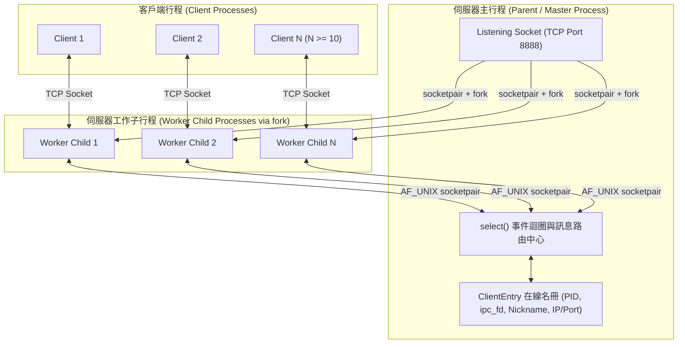
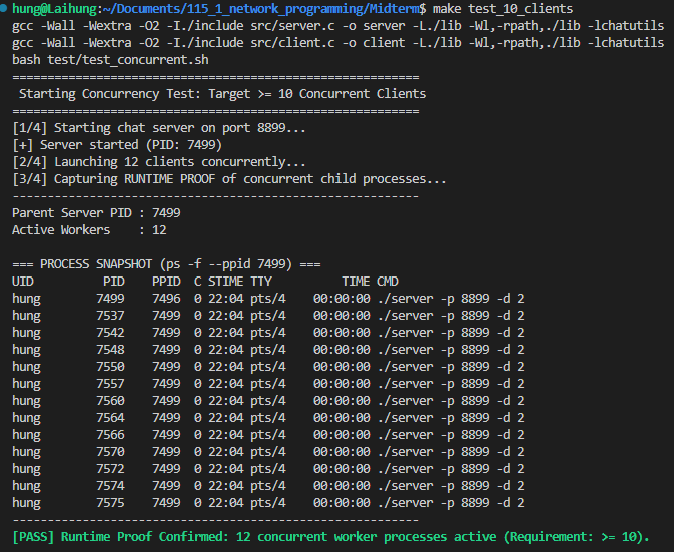
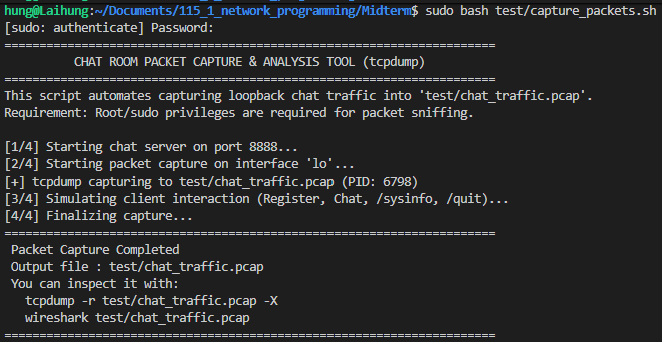
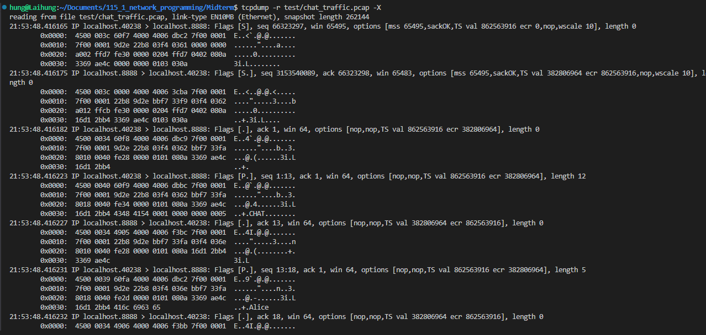
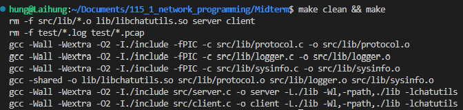
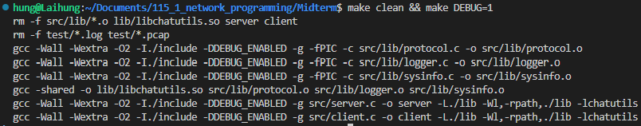
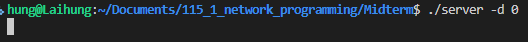
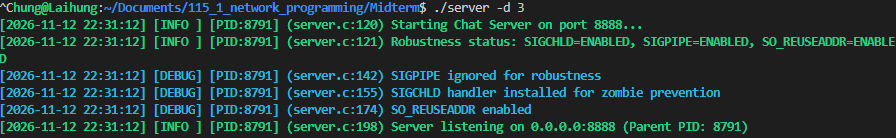
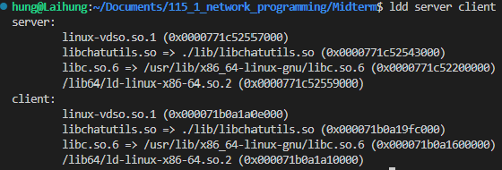
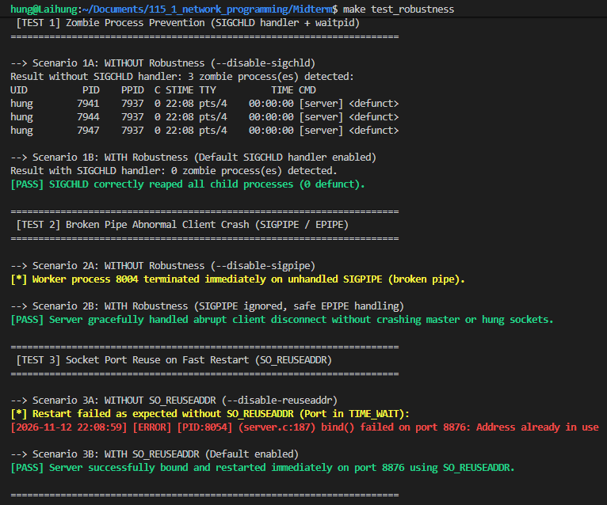

# 網路程式設計期中專案報告：Multi-Process Simple Chat Room

---

## 一、 系統設計說明（System Design Explanation）

本專案採用 C 語言於 Linux 環境實作一套基於 TCP/IP 的多行程（Multi-Process）聊天室應用程式，嚴格遵循單一連線獨立子行程（`fork()`）原則，不採用任何執行緒（Threads）。系統由伺服器（`server`）、客戶端（`client`）以及雙方共同動態連結的共享函式庫（`libchatutils.so`）三大元件構成。

### 1.1 多行程伺服器架構與 IPC 訊息轉發機制

在傳統單行程或執行緒架構中，所有客戶端的 Socket 描述元（File Descriptor）皆位於同一記憶體空間，廣播訊息僅需遍歷陣列即可完成；然而在本專案規定每條連線皆須以 `fork()` 建立獨立子行程的架構下，各子行程的記憶體空間彼此隔離，無法直接存取其他子行程所持有的 TCP Socket。

為解決跨行程廣播與私訊需求，本系統採用 **Master-Worker 架構搭配全雙工 `socketpair()` 行程間通訊（IPC）機制**：



運作流程如下：
1. 主行程（Parent Process）於 `accept()` 接收客戶端連線後，先呼叫 `socketpair(AF_UNIX, SOCK_STREAM, 0, sv)` 建立一對全雙工 UNIX Domain Socket，接著呼叫 `fork()` 派生子行程。
2. 子行程（Worker Process）關閉監聽 Socket 與 `sv[0]`，專責處理單一客戶端的 TCP 連線與 `sv[1]` IPC 通道，透過 `select()` 同時監聽雙方輸入。
3. 主行程關閉客戶端 TCP Socket 與 `sv[1]`，保留 `sv[0]` 並登錄至全域 `g_clients` 名冊，利用 `select()` 統一監聽新連線與所有子行程的 IPC 訊息，進行公開廣播、指定對象私訊、在線名單統整及系統資訊查詢。
4. 當任一子行程因客戶端斷線或異常終止時，其 `sv[0]` 會立即觸發 EOF，主行程隨即偵測並移除該客戶端紀錄，同時廣播離線通知，避免共用記憶體鎖死或資源洩漏。

### 1.2 應用層通訊協定設計（Packet Framing）

TCP 屬於無邊界的位元組流（Byte Stream），若直接以原始文字傳輸，在連續發送或高負載情況下容易發生黏包（Packet Sticking）或拆包（Packet Fragmentation）。為確保封包完整性，本系統定義固定 12 Bytes 檔頭搭配動態長度酬載（Payload），並於傳輸前統一轉換為網路位元組序（Big-Endian）：

| 欄位名稱 | 資料型別 | 長度 | 說明 |
| :--- | :--- | :--- | :--- |
| `magic` | `uint32_t` | 4 Bytes | 協定識別魔術數字 `0x43484154`（ASCII `'CHAT'`），用於過濾非法的連線資料。 |
| `msg_type` | `uint16_t` | 2 Bytes | 訊息型態代碼，定義系統指令與聊天內容分類（詳見下表）。 |
| `reserved` | `uint16_t` | 2 Bytes | 保留欄位，用於結構對齊與未來擴充旗標。 |
| `body_len` | `uint32_t` | 4 Bytes | 後續 Payload 資料長度（上限為 64 KB）。 |

支援之訊息型態代碼（`MsgType`）：
* `MSG_REGISTER (1)`：客戶端登入註冊或變更暱稱。
* `MSG_BROADCAST (2)`：公開聊天室廣播訊息。
* `MSG_WHISPER (3)`：一對一私訊（Payload 格式為 `target:content`）。
* `MSG_USER_LIST (4)`：請求與回傳當前在線使用者列表。
* `MSG_SYSINFO_REQ (5)`：客戶端向伺服器索取系統資訊（`/sysinfo`）。
* `MSG_SYSINFO_RESP (6)`：伺服器回傳系統狀態與硬體負載報告。
* `MSG_SERVER_NOTIFY (7)`：伺服器系統通知（歡迎訊息、上下線公告、錯誤提示）。
* `MSG_LEAVE (8)`：客戶端主動離線通知（`/quit` 或 `/exit`）。

### 1.3 專案目錄結構

```text
Midterm/
├── Makefile                    # 專案編譯、動態庫連結與自動化測試腳本入口
├── include/
│   ├── protocol.h              # 應用層封包結構與可靠傳輸介面宣告
│   ├── logger.h                # 編譯期與執行期雙層日誌控制介面
│   └── sysinfo.h               # 系統資訊擷取函式宣告
├── src/
│   ├── lib/
│   │   ├── protocol.c          # 封包序列化、網路位元組序轉換與 send_all/recv_all 實作
│   │   ├── logger.c            # 含時間戳記、PID 與等級過濾的日誌輸出實作
│   │   └── sysinfo.c           # 讀取 uname、sysinfo 與 /proc/loadavg 系統資訊
│   ├── server.c                # 多行程伺服器主程式（fork、IPC 路由、信號與穩健性處理）
│   └── client.c                # 終端機互動式客戶端（select 多工處理 stdin 與 socket）
├── lib/
│   └── libchatutils.so         # 編譯產出之共用動態連結函式庫
└── test/
    ├── test_concurrent.sh      # 10+ 客戶端並發連線測試與行程樹證明腳本
    ├── test_robustness.sh      # 三大穩健性防護機制對照驗證腳本
    └── capture_packets.sh      # tcpdump 本地迴環封包擷取腳本
```

---

## 二、 作業需求逐項說明與關鍵程式碼解析

本節依據作業規範之九項技術要求，逐項說明實作機制、關鍵程式碼設計與對應的執行驗證截圖。

### 2.1 多行程連線架構（`fork()` 實作與禁用執行緒）

#### 設計與實作說明
伺服器端完全未使用 `pthread` 相關函式庫。主行程於 `src/server.c` 中利用 `accept()` 取得新客戶端連線後，建立對應的 `socketpair`，隨即呼叫 `fork()` 產生子行程。父行程僅保留 IPC 描述元 `sv[0]` 並關閉 `client_fd`；子行程則關閉監聽中的 `listen_fd` 與 `sv[0]`，透過 `run_worker()` 進入獨立的 `select()` 事件迴圈處理單一客戶端收發。

#### 關鍵程式碼（`src/server.c:L251-L289`）
```c
int sv[2];
if (socketpair(AF_UNIX, SOCK_STREAM, 0, sv) < 0) {
    LOG_ERROR("socketpair() failed: %s", strerror(errno));
    close(client_fd);
} else {
    // 使用 fork() 建立子行程處理單一客戶端連線（嚴格禁止執行緒）
    pid_t pid = fork();
    if (pid < 0) {
        LOG_ERROR("fork() failed: %s", strerror(errno));
        close(sv[0]);
        close(sv[1]);
        close(client_fd);
    } else if (pid == 0) {
        // 子行程 (Worker)：關閉父行程專用描述元，專責服務該客戶端
        close(listen_fd);
        close(sv[0]);
        run_worker(client_fd, sv[1], client_ip, client_port);
        exit(0);
    } else {
        // 父行程 (Master)：關閉客戶端 TCP Socket，僅透過 sv[0] 與子行程通訊
        close(client_fd);
        close(sv[1]);
        // 將子行程 PID 與 IPC Socket 登錄至 g_clients 名冊
        ...
    }
}
```

---

### 2.2 支援至少 10 個客戶端同時連線與執行期證明（Concurrency & Runtime Proof）

#### 設計與實作說明
伺服器全域客戶端追蹤表 `g_clients` 上限設為 `MAX_CLIENTS (64)`，主行程與各子行程皆採用 `select()` 進行 I/O 多工處理。為提供明確的執行期證明（Runtime Proof），撰寫自動化測試腳本 `test/test_concurrent.sh`（透過 `make test_10_clients` 執行），同時於背景啟動 **12 個** 客戶端連線至伺服器，要求 `/sysinfo` 並進行聊天廣播，期間利用 `ps -f -p $SERVER_PID --ppid $SERVER_PID` 擷取父子行程狀態。

#### 關鍵程式碼（`src/server.c:L201-L220` 與 `src/server.c:L442-L504`）
主行程透過 `select()` 同時監控新連線與所有在線子行程之 `ipc_fd`：
```c
while (g_server_running) {
    fd_set read_fds;
    FD_ZERO(&read_fds);
    FD_SET(listen_fd, &read_fds);
    int max_fd = listen_fd;

    for (int i = 0; i < MAX_CLIENTS; i++) {
        if (g_clients[i].ipc_fd != -1) {
            FD_SET(g_clients[i].ipc_fd, &read_fds);
            if (g_clients[i].ipc_fd > max_fd) {
                max_fd = g_clients[i].ipc_fd;
            }
        }
    }

    int activity = select(max_fd + 1, &read_fds, NULL, NULL, &tv);
    ...
}
```

#### 執行截圖


**圖 1**：執行 `make test_10_clients` 結果。可見主伺服器行程（`PID 7499`）同時派生出 12 個子行程（`PPID 7499`，`PID 7537` 至 `7575`）處理 12 個並發連線，驗證通過至少 10 個同時連線的規範要求。

---

### 2.3 封包擷取與協定分析（`tcpdump` Loopback Traffic Analysis）

#### 設計與實作說明
透過 `test/capture_packets.sh` 自動化執行 `sudo tcpdump -i lo -c 50 -nn -s 0 port 8888 -w test/chat_traffic.pcap`，針對本地迴環介面（Loopback `lo`）側錄客戶端 `Alice` 連線註冊、發送廣播訊息、索取系統資訊（`/sysinfo`）以及離線（`/quit`）之完整 TCP 封包互動，再以 `tcpdump -r test/chat_traffic.pcap -X` 解析十六進位內容。

#### 執行截圖


**圖 2**：以 `sudo bash test/capture_packets.sh` 成功於 `lo` 介面擷取 Port 8888 流量並輸出 `test/chat_traffic.pcap`。



**圖 3**：透過 `tcpdump -r test/chat_traffic.pcap -X` 顯示 TCP 三向交握及自訂 `CHAT` 協定封包檔頭與負載。

#### 完整封包側錄紀錄與逐封包分析
以下為 `tcpdump -r test/chat_traffic.pcap -X` 輸出之完整擷取結果與協定解析：

```text
21:53:48.416165 IP localhost.40238 > localhost.8888: Flags [S], seq 66323297, win 65495, options [mss 65495,sackOK,TS val 862563916 ecr 0,nop,wscale 10], length 0
        0x0000:  4500 003c 60f7 4000 4006 dbc2 7f00 0001  E..<`.@.@.......
        0x0010:  7f00 0001 9d2e 22b8 03f4 0361 0000 0000  ......"....a....
        0x0020:  a002 ffd7 fe30 0000 0204 ffd7 0402 080a  .....0..........
        0x0030:  3369 ae4c 0000 0000 0103 030a            3i.L........
21:53:48.416175 IP localhost.8888 > localhost.40238: Flags [S.], seq 3153540089, ack 66323298, win 65483, options [mss 65495,sackOK,TS val 382806964 ecr 862563916,nop,wscale 10], length 0
...
21:53:48.416182 IP localhost.40238 > localhost.8888: Flags [.], ack 1, win 64, options [nop,nop,TS val 862563916 ecr 382806964], length 0
...
21:53:48.416223 IP localhost.40238 > localhost.8888: Flags [P.], seq 1:13, ack 1, win 64, options [nop,nop,TS val 862563916 ecr 382806964], length 12
        0x0000:  4500 0040 60f9 4000 4006 dbbc 7f00 0001  E..@`.@.@.......
        0x0010:  7f00 0001 9d2e 22b8 03f4 0362 bbf7 33fa  ......"....b..3.
        0x0020:  8018 0040 fe34 0000 0101 080a 3369 ae4c  ...@.4......3i.L
        0x0030:  16d1 2bb4 4348 4154 0001 0000 0000 0005  ..+.CHAT........
21:53:48.416231 IP localhost.40238 > localhost.8888: Flags [P.], seq 13:18, ack 1, win 64, options [nop,nop,TS val 862563916 ecr 382806964], length 5
        0x0030:  16d1 2bb4 416c 6963 65                   ..+.Alice
21:53:48.416283 IP localhost.40238 > localhost.8888: Flags [P.], seq 18:30, ack 1, win 64, options [nop,nop,TS val 862563916 ecr 382806964], length 12
        0x0030:  16d1 2bb4 4348 4154 0002 0000 0000 0023  ..+.CHAT.......#
21:53:48.416287 IP localhost.40238 > localhost.8888: Flags [P.], seq 30:65, ack 1, win 64, options [nop,nop,TS val 862563916 ecr 382806964], length 35
        0x0030:  16d1 2bb4 4865 6c6c 6f2c 2074 6869 7320  ..+.Hello,.this.
        0x0040:  6973 2061 2074 6573 7420 6368 6174 206d  is.a.test.chat.m
        0x0050:  6573 7361 6765 21                        essage!
21:53:48.416557 IP localhost.8888 > localhost.40238: Flags [P.], seq 1:13, ack 65, win 64, options [nop,nop,TS val 382807465 ecr 862564417], length 12
        0x0030:  3369 ae4c 4348 4154 0007 0000 0000 003a  3i.LCHAT.......:
21:53:48.416578 IP localhost.8888 > localhost.40238: Flags [P.], seq 13:71, ack 65, win 64, options [nop,nop,TS val 382806964 ecr 862563916], length 58
        0x0030:  3369 ae4c 5765 6c63 6f6d 6520 746f 2053  3i.LWelcome.to.S
        0x0040:  696d 706c 6520 4368 6174 2052 6f6f 6d21  imple.Chat.Room!
        0x0050:  0a54 7970 6520 2f68 656c 7020 666f 7220  .Type./help.for.
        0x0060:  636f 6d6d 616e 6420 6c69 7374 2e0a       command.list..
21:53:48.416675 IP localhost.8888 > localhost.40238: Flags [P.], seq 71:83, ack 65, win 64, options [nop,nop,TS val 382806964 ecr 862563916], length 12
        0x0030:  3369 ae4c 4348 4154 0007 0000 0000 0023  3i.LCHAT.......#
21:53:48.416679 IP localhost.8888 > localhost.40238: Flags [P.], seq 83:118, ack 65, win 64, options [nop,nop,TS val 382806964 ecr 862563916], length 35
        0x0030:  3369 ae4c 5b2a 5d20 5573 6572 5f36 3833  3i.L[*].User_683
        0x0040:  3220 6973 206e 6f77 206b 6e6f 776e 2061  2.is.now.known.a
        0x0050:  7320 416c 6963 65                        s.Alice
21:53:48.917204 IP localhost.40238 > localhost.8888: Flags [P.], seq 65:77, ack 118, win 64, options [nop,nop,TS val 862564417 ecr 382806964], length 12
        0x0030:  16d1 2bb4 4348 4154 0005 0000 0000 0000  ..+.CHAT........
21:53:48.917546 IP localhost.8888 > localhost.40238: Flags [P.], seq 118:130, ack 77, win 64, options [nop,nop,TS val 382807465 ecr 862564417], length 12
        0x0030:  3369 b041 4348 4154 0006 0000 0000 0172  3i.ACHAT.......r
21:53:48.917568 IP localhost.8888 > localhost.40238: Flags [P.], seq 130:500, ack 77, win 64, options [nop,nop,TS val 382807465 ecr 862564417], length 370
        0x0030:  3369 b041 3d3d 3d3d 3d3d 3d3d 3d3d 3d3d  3i.A============
        0x0040:  3d3d 3d3d 205b 2053 4552 5645 5220 5359  ====.[.SERVER.SY
        ...
        0x0150:  3a20 3637 3931 0a20 2041 6374 6976 6520  :.6791...Active.
        0x0160:  436c 6965 6e74 7320 2020 3a20 310a 3d3d  Clients...:.1.==
        ...
21:53:49.419724 IP localhost.40238 > localhost.8888: Flags [P.], seq 77:89, ack 500, win 64, options [nop,nop,TS val 862564919 ecr 382807465], length 12
        0x0030:  16d1 2da9 4348 4154 0008 0000 0000 0000  ..-.CHAT........
21:53:49.419756 IP localhost.40238 > localhost.8888: Flags [FP.], seq 89:101, ack 500, win 64, options [nop,nop,TS val 862564919 ecr 382807465], length 12
        0x0030:  16d1 2da9 4348 4154 0008 0000 0000 0000  ..-.CHAT........
21:53:49.419846 IP localhost.8888 > localhost.40238: Flags [R.], seq 500, ack 102, win 64, options [nop,nop,TS val 382807967 ecr 862564919], length 0
```

封包內容結構解析如下：
1. **TCP 三向交握（`21:53:48.416165` - `.416182`）**：Client（Port `40238`）向 Server（Port `8888`）依序交換 `Flags [S]`、`Flags [S.]`、`Flags [.]` 完成連線建立。
2. **客戶端註冊（`21:53:48.416223` - `.416231`）**：Client 先傳送 12 Bytes 檔頭 `4348 4154 0001 0000 0000 0005`，對照協定依序為 Magic `'CHAT'`、型態 `0x0001`（`MSG_REGISTER`）、長度 `5` Bytes；下一筆封包隨即傳送 `416c 6963 65`（ASCII `"Alice"`）。
3. **公開廣播訊息（`21:53:48.416283` - `.416287`）**：檔頭為 `4348 4154 0002 0000 0000 0023`（`MSG_BROADCAST`，長度 `0x23` = 35 Bytes），緊接傳送 `"Hello, this is a test chat message!"`。
4. **系統通知與歡迎訊息（`21:53:48.416557` - `.416679`）**：Server 回傳 `0x0007`（`MSG_SERVER_NOTIFY`），先後送出 58 Bytes 歡迎詞與 35 Bytes 更名公告 `[*] User_6832 is now known as Alice`。
5. **系統資訊索取與回應（`21:53:48.917204` - `.917568`）**：Client 送出 `4348 4154 0005 0000 0000 0000`（`MSG_SYSINFO_REQ`，長度 0），Server 隨即回覆 `4348 4154 0006 0000 0000 0172`（`MSG_SYSINFO_RESP`，長度 `0x0172` = 370 Bytes）以及包含核心版本、運行時間、負載與記憶體使用率之系統資訊卡片。
6. **連線結束分析（`21:53:49.419724` - `.419846`）**：Client 送出 `0x0008`（`MSG_LEAVE`）通知離線；透過本次 `tcpdump` 側錄亦觀察到，Client 在 `/quit` 指令分岐與跳出迴圈後的收尾區段各發送了一次 `MSG_LEAVE`，使 Server 關閉 Socket 後針對第二筆封包回應了 `Flags [R.]`（TCP Reset）。

---

### 2.4 雙層除錯日誌控制（Compile-Time & Runtime Debug Log）

#### 設計與實作說明
本系統同時支援 **編譯期** 與 **執行期** 雙層級日誌控制：
1. **編譯期控制（Compile-Time）**：於 `Makefile` 提供 `DEBUG=1` 參數，加入 `-DDEBUG_ENABLED -g` 旗標。在 `include/logger.h` 中，若未定義 `DEBUG_ENABLED`，`LOG_DEBUG(...)` 將於前處理器階段直接展開為 `do {} while (0)`，對正式發行版程式不產生任何執行時期效能負擔與二進位體積。
2. **執行期控制（Runtime）**：`src/lib/logger.c` 維護全域變數 `g_current_log_level`（`0: ERROR`、`1: WARN`、`2: INFO`、`3: DEBUG`），支援啟動時透過 `-d <level>` 參數動態切換輸出詳細程度，每行日誌皆自動附加時間戳記、日誌等級、行程 `PID` 與原始碼行號。

#### 關鍵程式碼（`include/logger.h:L7-L27` 與 `src/lib/logger.c:L9-L24`）
```c
// include/logger.h
typedef enum {
    LOG_LVL_ERROR = 0,
    LOG_LVL_WARN  = 1,
    LOG_LVL_INFO  = 2,
    LOG_LVL_DEBUG = 3
} LogLevel;

#ifdef DEBUG_ENABLED
#define LOG_DEBUG(fmt, ...) log_message(LOG_LVL_DEBUG, __FILE__, __LINE__, fmt, ##__VA_ARGS__)
#else
#define LOG_DEBUG(fmt, ...) do {} while (0)
#endif
```

```c
// src/lib/logger.c
void log_message(LogLevel level, const char *file, int line, const char *fmt, ...) {
    if (level > g_current_log_level) {
        return;
    }
    ...
}
```

#### 執行截圖


**圖 4**：一般編譯模式（`make clean && make`），編譯指令未帶有 `-DDEBUG_ENABLED`，`LOG_DEBUG` 巨集於前處理階段即被移除。



**圖 5**：除錯編譯模式（`make clean && make DEBUG=1`），編譯指令自動附加 `-DDEBUG_ENABLED -g`，將除錯日誌與符號表編譯至動態庫與執行檔中。



**圖 6**：在 `DEBUG=1` 編譯後以執行期等級 `-d 0`（僅輸出 `ERROR`）啟動伺服器，常規 `INFO` 與 `DEBUG` 訊息皆被動態過濾隱藏。



**圖 7**：同一執行檔改以執行期等級 `-d 3`（開啟至 `DEBUG`）啟動，完整印出 `[INFO ]` 與 `[DEBUG]` 等級之信號註冊、Socket 選項與行程 PID 細節。

---

### 2.5 動態共享函式庫封裝與連結（`.so` Shared Library）

#### 設計與實作說明
所有 Client 與 Server 共用的核心元件（封包協定 `protocol.c`、日誌系統 `logger.c`、系統資訊收集 `sysinfo.c`）皆先以 `-fPIC`（Position-Independent Code）編譯為目的檔，再透過 `gcc -shared` 打包為動態共享函式庫 `lib/libchatutils.so`。編譯 `server` 與 `client` 時透過 `-L./lib -Wl,-rpath,./lib -lchatutils` 設定執行期搜尋路徑（RPATH），不需更動系統全域 `/usr/lib` 或設定環境變數即可直接載入執行。

#### 關鍵程式碼（`Makefile:L24-L39`）
```makefile
$(SRC_DIR)/lib/%.o: $(SRC_DIR)/lib/%.c
	@mkdir -p $(LIB_DIR)
	$(CC) $(CFLAGS) -fPIC -c $< -o $@

$(SHARED_LIB): $(LIB_OBJS)
	@mkdir -p $(LIB_DIR)
	$(CC) -shared -o $@ $^

server: $(SRC_DIR)/server.c $(SHARED_LIB)
	$(CC) $(CFLAGS) $< -o $@ $(LDFLAGS)

client: $(SRC_DIR)/client.c $(SHARED_LIB)
	$(CC) $(CFLAGS) $< -o $@ $(LDFLAGS)
```

#### 執行截圖


**圖 8**：執行 `ldd server client` 輸出結果，明確顯示 `server` 與 `client` 雙方皆正確動態連結至 `./lib/libchatutils.so`。

---

### 2.6 特色功能設計：系統資訊查詢（`/sysinfo`）與聊天室指令

#### 設計與實作說明
本系統實作多項應用層互動指令，其中 `/sysinfo` 負責向伺服器請求運行主機之即時系統狀態。當 Client 送出 `MSG_SYSINFO_REQ` 後，Worker 子行程經由 IPC 轉達主行程，主行程呼叫封裝於 `libchatutils.so` 內的 `get_system_info_string()` 函式：
1. 呼叫 POSIX `uname()` 取得作業系統名稱、Linux 核心版本與硬體架構。
2. 呼叫 Linux `sysinfo()` 取得系統總運行時間（Uptime）與記憶體總量／剩餘量。
3. 讀取 `/proc/loadavg` 解析 1 分鐘、5 分鐘、15 分鐘之平均 CPU 負載。
4. 結合主行程維護的即時連線人數 `g_client_count` 與行程 PID 格式化回傳。

此外系統亦提供公開訊息廣播、私訊指定使用者（`/msg <user> <text>`）、查詢線上名冊（`/list`）、動態更名（`/nick <new_name>`）、指令說明（`/help`）與離線（`/quit`）。

#### 關鍵程式碼（`src/lib/sysinfo.c:L9-L66`）
```c
int get_system_info_string(char *buffer, size_t max_len, int active_clients) {
    struct utsname un;
    uname(&un);

    struct sysinfo si;
    if (sysinfo(&si) == 0) {
        uptime = si.uptime;
        unsigned long mem_unit = si.mem_unit ? si.mem_unit : 1;
        total_ram_mb = (si.totalram * mem_unit) / (1024 * 1024);
        free_ram_mb = (si.freeram * mem_unit) / (1024 * 1024);
    }

    double load1 = 0.0, load5 = 0.0, load15 = 0.0;
    FILE *fp = fopen("/proc/loadavg", "r");
    if (fp) {
        if (fscanf(fp, "%lf %lf %lf", &load1, &load5, &load15) != 3) {
            load1 = load5 = load15 = 0.0;
        }
        fclose(fp);
    }
    ...
}
```

---

### 2.7 系統穩健性機制與三組異常情境對照（Robustness Mechanisms）

#### 設計與實作說明
為應對網路程式設計常見的行程殘留、斷線崩潰、埠號佔用與串流資料截斷等異常狀況，系統實作以下四項穩健性機制，並於伺服器設計命令列開關（`--disable-sigchld`、`--disable-sigpipe`、`--disable-reuseaddr`），透過 `make test_robustness` 進行「有／無防護機制」的對照演示：

1. **殭屍行程回收機制（`SIGCHLD` + `waitpid`）**：
   * **問題**：客戶端斷線導致 Worker 子行程結束後，若父行程未呼叫 `waitpid()` 回收退出狀態，該子行程將殘留於系統行程表成為 `<defunct>` 殭屍行程，長期運作會耗盡系統 PID 資源。
   * **對策**：註冊 `SIGCHLD` 信號處理器 `handle_sigchld()`，於迴圈中以非阻塞旗標 `WNOHANG` 徹底回收所有已結束之子行程。
2. **異常斷線 Broken Pipe 防護（`SIGPIPE` Ignore + `EPIPE` 檢查）**：
   * **問題**：若客戶端行程遭強制終止（如 `kill -9`）而未經正常 TCP 四向揮手，伺服器試圖向已破裂之 Socket 寫入資料時，Linux 核心會發出 `SIGPIPE` 信號，其預設行為將直接終止伺服器行程。
   * **對策**：設定 `signal(SIGPIPE, SIG_IGN)` 忽略信號，並於 `send_all()` 檢查 `write()` 回傳值與 `errno`，當偵測到寫入失敗時安全回收對應資源並關閉 Socket。
3. **伺服器快速重啟埠號重用（`SO_REUSEADDR`）**：
   * **問題**：伺服器主行程若於連線中斷或強制重啟後立即重新啟動，原 TCP Socket 可能仍處於 `TIME_WAIT` 狀態，導致 `bind()` 失敗並回傳 `EADDRINUSE`（Address already in use）。
   * **對策**：於 `bind()` 前透過 `setsockopt()` 啟用 `SO_REUSEADDR` 選項，允許伺服器立即重綁同一埠號恢復服務。
4. **TCP 串流部分讀寫與封包邊界保護（`send_all` / `recv_all`）**：
   * **對策**：於 `src/lib/protocol.c` 以迴圈處理部分傳送／接收及 `EINTR` 信號中斷重試，並檢驗 `PROTO_MAGIC` 與 `MAX_PAYLOAD_LEN` 上限，防止惡意封包造成過大記憶體配置。

#### 關鍵程式碼（`src/server.c:L54-L64` 與 `src/server.c:L139-L178`）
```c
static void handle_sigchld(int sig) {
    (void)sig;
    int saved_errno = errno;
    pid_t pid;
    int status;
    // 非阻塞式回收所有已終止之子行程，避免產生殭屍行程
    while ((pid = waitpid(-1, &status, WNOHANG)) > 0) {
        LOG_DEBUG("Reaped terminated child process PID: %d", pid);
    }
    errno = saved_errno;
}
```

#### 執行截圖


**圖 9**：執行 `make test_robustness` 產出之三組對照展示結果：
* **[TEST 1]**：停用 `SIGCHLD` 處理後殘留 3 個 `[server] <defunct>` 殭屍行程；啟用後即時回收為 0 個。
* **[TEST 2]**：停用 `SIGPIPE` 防護時，客戶端異常斷線導致 Worker `8004` 立即遭信號強制終止；啟用後主伺服器與其餘連線皆平穩運作。
* **[TEST 3]**：停用 `SO_REUSEADDR` 時，於 `TIME_WAIT` 狀態下重啟伺服器發生 `bind() failed on port 8876: Address already in use` 錯誤；啟用後立即重新綁定並啟動成功。

---

### 2.8 專案建置系統（`Makefile`）

本專案完全由根目錄之 `Makefile` 統一管理建置與測試流程，支援以下目標指令：
* `make` / `make all`：編譯動態共享函式庫 `lib/libchatutils.so` 及 `server`、`client` 兩支執行檔（預設開啟 `-Wall -Wextra -O2`）。
* `make DEBUG=1`：開啟編譯期 `-DDEBUG_ENABLED -g` 除錯選項重新編譯專案。
* `make test_10_clients`：自動編譯並執行 12 客戶端並發壓力測試與行程證明腳本。
* `make test_robustness`：自動編譯並執行三大穩健性對照展示腳本。
* `make clean`：清除所有目的檔、動態函式庫、執行檔與測試產出日誌／封包檔。

---

## 三、 附錄：專案檔案說明（Project File Summary）

本專案各程式碼與腳本檔案之職責與功能彙整如下表：

| 檔案路徑 | 類型 | 功能與實作內容說明 |
| :--- | :--- | :--- |
| `Makefile` | 建置腳本 | 定義共享函式庫 `libchatutils.so`（`-fPIC -shared`）、`server` 與 `client`（`-Wl,-rpath,./lib`）編譯規則，並提供 `DEBUG=1` 編譯開關、`test_10_clients`、`test_robustness` 與 `clean` 目標。 |
| `include/protocol.h` | 標頭檔 | 定義應用層協定魔術數字 `PROTO_MAGIC`、`MsgType` 列舉、固定 12 Bytes `PacketHeader` 結構體，以及封包收發函式介面。 |
| `include/logger.h` | 標頭檔 | 定義四級日誌等級 `LogLevel`（`ERROR` 至 `DEBUG`）、執行期等級設定介面，以及編譯期條件巨集 `LOG_DEBUG`（未定義 `DEBUG_ENABLED` 時展開為空陳述式）。 |
| `include/sysinfo.h` | 標頭檔 | 宣告 `get_system_info_string()` 函式，作為伺服器回應 `/sysinfo` 請求之共用介面。 |
| `src/lib/protocol.c` | 共享函式庫原始碼 | 實作 `send_all()` 與 `recv_all()` 處理 TCP 部分讀寫與 `EINTR` 中斷重試；實作 `send_packet()` 與 `recv_packet()` 進行網路位元組序轉換、檔頭驗證與動態配置酬載緩衝區。 |
| `src/lib/logger.c` | 共享函式庫原始碼 | 實作執行期日誌等級過濾、ANSI 終端彩色輸出、本地時間戳記、目前行程 `PID` 與來源檔案行號格式化列印。 |
| `src/lib/sysinfo.c` | 共享函式庫原始碼 | 透過 POSIX `uname()`、Linux `sysinfo()` 及讀取 `/proc/loadavg`，組裝作業系統核心版本、開機時間、CPU 平均負載、記憶體使用狀況與即時連線數報告。 |
| `src/server.c` | 主程式原始碼 | 實作多行程伺服器：初始化 `SIGCHLD`/`SIGPIPE`/`SO_REUSEADDR` 穩健性防護與測試開關，主行程透過 `select()` 監控新連線並以 `socketpair()` + `fork()` 建立 Worker 子行程負責訊息路由與指令處理。 |
| `src/client.c` | 主程式原始碼 | 實作終端機互動式客戶端：解析連線與日誌參數，完成連線與暱稱註冊後，以 `select()` 同時監聽標準輸入（`stdin`）與伺服器 Socket，支援公開廣播、`/sysinfo`、`/list`、`/msg`、`/nick` 與 `/quit` 指令。 |
| `test/test_concurrent.sh` | 自動化測試腳本 | 啟動伺服器並同時派生 12 個背景客戶端連線交換訊息與系統資訊，利用 `ps -f` 驗證同時存在 $\ge 10$ 個 Worker 子行程，產出執行期證明。 |
| `test/test_robustness.sh` | 自動化測試腳本 | 依序演示停用與啟用 `SIGCHLD`（殭屍行程）、`SIGPIPE`（異常斷線）與 `SO_REUSEADDR`（重啟埠號佔用）三組穩健性對照實驗。 |
| `test/capture_packets.sh` | 封包側錄腳本 | 自動化啟動伺服器與 `tcpdump` 側錄本機迴環介面（`lo`）Port 8888 流量，並模擬客戶端操作流程以匯出 `test/chat_traffic.pcap`。 |