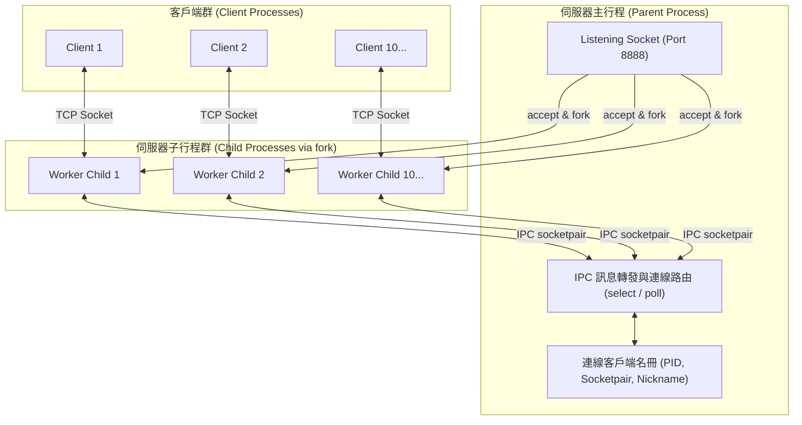
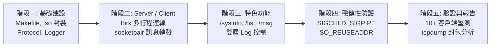

# 網路程式設計期中專案：Simple Chat Room 實作架構規劃書

本規劃書依據 [README.md](file:///home/hung/Documents/115_1_network_programming/Midterm/README.md) 的全部規範與驗證要求，擬定完整的系統架構、模組切分、通訊協定、穩健性機制與測試計畫。

---

## 一、 需求對照與技術選型矩陣

| README 要求項目 | 技術實現方案 | 說明 |
| :--- | :--- | :--- |
| **禁止使用執行緒 (No Threads)** | `fork()` 產生子行程獨立處理連線 | 父行程監聽並管理，每個連線派生 1 個子行程 |
| **支援 $\ge 10$ 客戶端同時連線** | `select()` 多工 + IPC 訊息轉發 | 提供自動化測試腳本啟動 12+ 行程並驗證行程狀態 |
| **雙層 Debug Log 控制** | 編譯期巨集 + 執行期等級參數 | 編譯期 `-DDEBUG` + 執行期 `-d <level>` 或 `-v` |
| **動態共享函式庫 (.so)** | `libchatutils.so` | 封裝協定封包、日誌模組、系統資訊收集等共用函式 |
| **向伺服器索取系統資訊** | 指令 `/sysinfo` (MSG_SYSINFO) | 抓取 OS、Uptime、CPU 負載、記憶體及在線人數 |
| **穩健性機制 (Robustness)** | SIGCHLD、SIGPIPE、SO_REUSEADDR | 提供至少 3 組「有/無機制」的對照測試展示腳本 |
| **封包擷取與分析** | `tcpdump` / Wireshark 腳本 | 本地 Loopback (`lo`) 擷取自定義二進位/文字協定封包 |
| **建置系統** | `Makefile` | 包含 `all`, `lib`, `server`, `client`, `test`, `clean` |

---

## 二、 系統架構設計 (System Architecture)

### 2.1 多行程聊天室架構與 IPC 選擇

在多行程架構中，每個子行程獨立掌管一個客戶端的 TCP Socket。由於子行程之間無法直接存取對方的 Socket 描述元，必須設計 **IPC (Inter-Process Communication)** 來進行訊息廣播。



#### 推薦 IPC 機制：**雙向 Socketpair + 主行程轉發**
* **運作原理**：
  1. 父行程在 `fork()` 前呼叫 `socketpair(AF_UNIX, SOCK_STREAM, 0, sv)` 建立全雙工 IPC 通道。
  2. `fork()` 後，子行程保留 `sv[1]`，關閉 `sv[0]`；父行程保留 `sv[0]`，關閉 `sv[1]`。
  3. 子行程使用 `select()` 同時監聽「客戶端 TCP Socket」與「父行程 IPC 通道」。
  4. 當 Client 傳送聊天訊息時：`Client` $\to$ `Worker` $\to$ `Parent` $\to$ `所有其他 Workers` $\to$ `所有其他 Clients`。
* **優點**：
  * **容錯性極佳**：若某個子行程異常當機，父行程的 `sv[0]` 會立刻收到 `POLLHUP` / EOF，父行程可自動回收殭屍行程並向全體廣播該使用者離線，不會發生共用記憶體鎖死 (Deadlock) 或髒資料殘留。
  * 符合網路程式設計標準範式，完全使用 BSD Socket API。

---

## 三、 目錄結構與模組規劃

```text
Midterm/
├── Makefile                # 專案編譯與測試建置檔
├── README.md               # 專案說明與規範
├── include/
│   ├── protocol.h          # 應用層通訊協定定義與封包資料結構
│   ├── logger.h            # 雙層 Debug Log 巨集與函式宣告
│   └── sysinfo.h           # 系統硬體/負載資訊讀取函式
├── src/
│   ├── lib/
│   │   ├── protocol.c      # 封包序列化、反序列化、安全 send_all/recv_all
│   │   ├── logger.c        # 執行期 Log Level 輸出實作
│   │   └── sysinfo.c       # 採集 /proc/loadavg, sysinfo(), uname 等
│   ├── server.c            # 伺服器主程式 (fork、IPC 轉發、信號處理)
│   └── client.c            # 客戶端主程式 (select 處理 stdin 與 socket)
├── lib/
│   └── libchatutils.so     # 編譯產出的動態共享函式庫
└── test/
    ├── test_concurrent.sh  # 驗證 10+ 客戶端同時連線腳本 (Runtime proof)
    ├── test_robustness.sh  # 3 大穩健性對照測試腳本
    └── capture_packets.sh  # tcpdump 自動抓包與分析腳本
```

---

## 四、 核心功能與協定設計 (Protocol Design)

### 4.1 封包格式 (Framing & Serialization)
為避免 TCP 黏包 (Sticking) 與分包 (Fragmentation)，所有傳輸均採用固定檔頭 + 動態負載：

```c
#pragma pack(push, 1)
typedef struct {
    uint32_t magic;         // 魔術數字: 0x43484154 ('CHAT')
    uint16_t msg_type;      // 訊息類型代碼 (見下表)
    uint16_t reserved;      // 保留對齊
    uint32_t body_len;      // 負載資料長度
} PacketHeader;
#pragma pack(pop)
```

### 4.2 訊息型態代碼 (`msg_type`)
* `MSG_REGISTER (1)`: 客戶端登入並設定暱稱。
* `MSG_BROADCAST (2)`: 公開聊天室廣播訊息。
* `MSG_WHISPER (3)`: 私訊指定使用者 (`/msg <user> <text>`)。
* `MSG_USER_LIST (4)`: 查詢在線使用者清單 (`/list`)。
* `MSG_SYSINFO_REQ (5)`: 客戶端索取伺服器系統資訊 (`/sysinfo`)。
* `MSG_SYSINFO_RESP (6)`: 伺服器回應系統資訊。
* `MSG_SERVER_NOTIFY (7)`: 系統提示訊息 (如使用者進出廣播、錯誤通知)。
* `MSG_LEAVE (8)`: 客戶端優雅離線 (`/exit` 或 `/quit`)。

---

## 五、 關鍵要求之細部設計

### 5.1 雙層除錯日誌機制 (Debug Log Control)

1. **編譯期控制 (Compile-Time)**：
   * 透過 `make DEBUG=1` 在編譯時加入 `-DDEBUG_ENABLED`。
   * 未定義時，`LOG_DEBUG(...)` 在前處理器階段直接展開為空陳述式 `((void)0)`，對發行版二進位檔零效能損耗。
2. **執行期控制 (Runtime)**：
   * 程式啟動時解析參數：`./server -d <level>` 或環境變數 `DEBUG_LEVEL` (0=ERROR, 1=WARN, 2=INFO, 3=DEBUG)。
   * 只有在當前執行等級大於等於該日誌等級時才列印輸出，附帶時間戳記與彩色輸出。

### 5.2 動態共享函式庫 (`.so`)
* 編譯方式：
  ```bash
  gcc -fPIC -c src/lib/protocol.c src/lib/logger.c src/lib/sysinfo.c -Iinclude
  gcc -shared -o lib/libchatutils.so protocol.o logger.o sysinfo.o
  ```
* 連結方式：
  * 編譯伺服器與客戶端時加入 `-L./lib -lchatutils -Wl,-rpath,./lib`，確保執行時自動載入同目錄下的 `.so`，不依賴全域安裝路徑。

### 5.3 系統資訊功能 (`/sysinfo`)
封裝於 `libchatutils.so` 中，利用 Linux 原生系統呼叫與虛擬檔案系統收集：
1. **OS / 核心版本**：呼叫 `uname()` 取得系統核心及發行資訊。
2. **Uptime & 記憶體狀況**：呼叫 `sysinfo()` 取得開機時間與可用記憶體。
3. **CPU 負載**：解析 `/proc/loadavg` 取得 1/5/15 分鐘平均負載。
4. **聊天室在線數據**：伺服器子行程統計在線客戶端數量、當前伺服器行程 PID。

---

## 六、 穩健性機制設計與 3 大對照測試範例 (Robustness)

作業要求提供 **至少 3 組執行範例** 展示「有實作」與「未實作」穩健性機制的行為差異：

| 測試案例 | 異常狀況描述 | 未實作機制行為 (Failure Mode) | 有實作機制行為 (Robust Mode) |
| :--- | :--- | :--- | :--- |
| **案例 1：殭屍行程防範 (Zombie Reaping)** | 客戶端離線，子行程終止退出 | 子行程未被父行程 `waitpid` 回收，變成 `<defunct>` 殭屍行程，佔滿行程表 PID | 父行程註冊 `SIGCHLD` 信號處理器，非阻塞式 `waitpid(-1, NULL, WNOHANG)` 自動即時回收 |
| **案例 2：客戶端異常斷線 (Broken Pipe)** | 客戶端突然 `kill -9`，伺服器向已關閉 Socket 寫入 | 系統對伺服器發出 `SIGPIPE`，預設導致伺服器行程無預警直接崩潰終止 | 伺服器設定 `signal(SIGPIPE, SIG_IGN)` 或 `MSG_NOSIGNAL`，捕獲 `EPIPE` 錯誤碼並安全清理連線 |
| **案例 3：伺服器重啟埠號佔用 (Address in use)** | 伺服器異常終止或手動快速重啟 | TCP Socket 處於 `TIME_WAIT` 狀態，重啟時 `bind()` 失敗 (`EADDRINUSE`) | 建立 Socket 時啟用 `SO_REUSEADDR` 選項，伺服器可立即重啟綁定同一埠號 |

> [!TIP]
> 實作技巧：可在程式碼中透過命令列參數 (如 `--no-robustness` 或編譯旗標) 模擬未開啟防護的情境，並由測試腳本 `test/test_robustness.sh` 自動化演示兩者對照結果。

---

## 七、 實作時程與驗收步驟



1. **階段一：共用庫與基礎建設**
   * 定義 `include/protocol.h`、`include/logger.h`、`include/sysinfo.h`。
   * 實作 `libchatutils.so` 與 `Makefile`，確認共用動態庫建置與連結正常。
2. **階段二：伺服器與客戶端骨幹**
   * 實作 `server.c`：`fork()` 子行程、`socketpair` 建立父子 IPC。
   * 實作 `client.c`：終端機互動輸入與 `select()` 監聽輸出。
3. **階段三：功能擴充**
   * 加入廣播、私訊、在線名冊、`/sysinfo` 系統資訊查詢。
   * 驗證編譯期及執行期 Debug Log 切換。
4. **階段四：穩健性實作與對照展示**
   * 實作三項穩健性機制，編寫 `test/test_robustness.sh` 產生對照成果。
5. **階段五：效能壓測與報告產出**
   * 編寫 `test/test_concurrent.sh` 啟動 10~15 個連線，記錄 `ps` 行程樹以作 Runtime proof。
   * 執行 `tcpdump` 產出 pcap 檔案以供報告分析。
